# NIKHAAR — Luxury Skincare & Beauty India

NIKHAAR is a premium skincare and beauty storefront built with Next.js. It is designed for the Indian beauty market and showcases Ayurvedic, clinical, and modern skincare products with a luxury retail experience, educational content, and a conversion-focused shopping flow.

## Preview
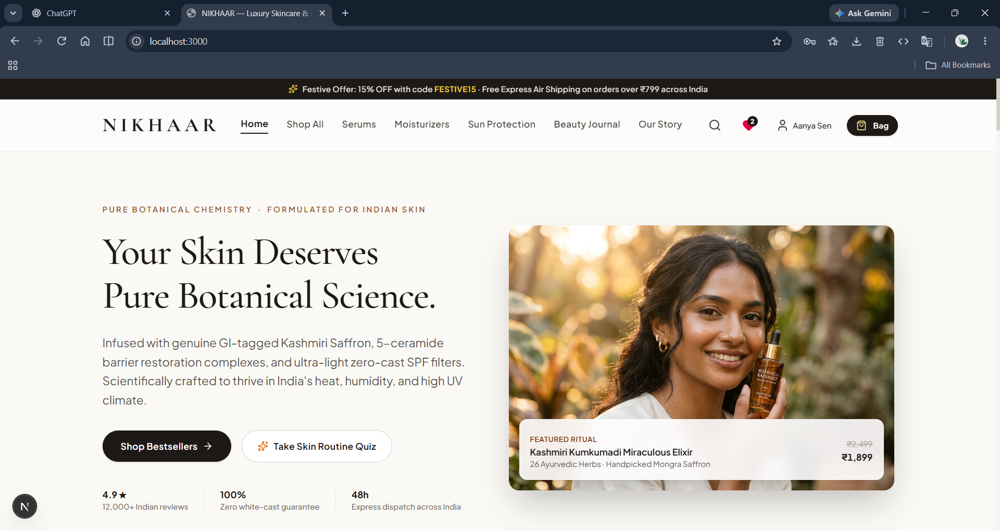
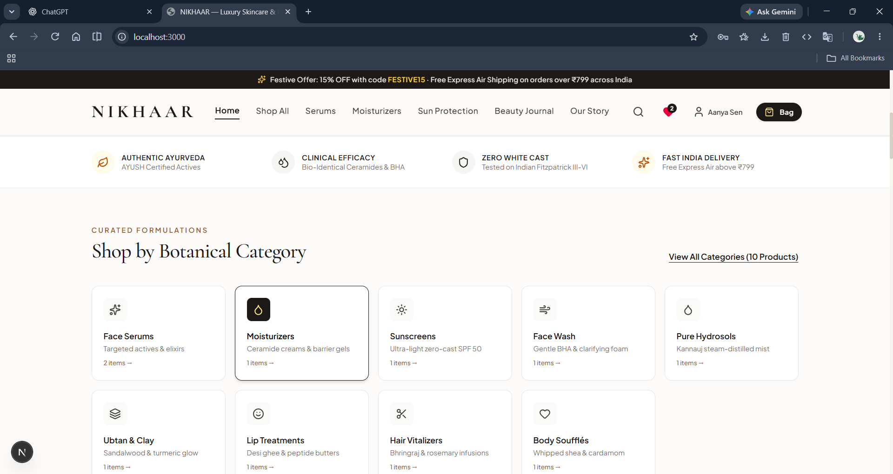
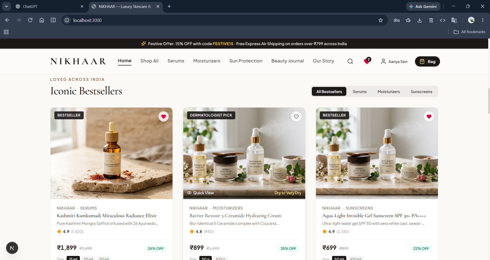
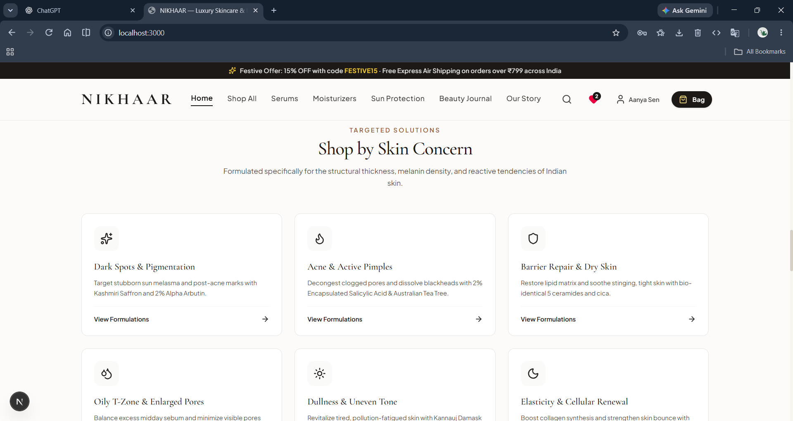
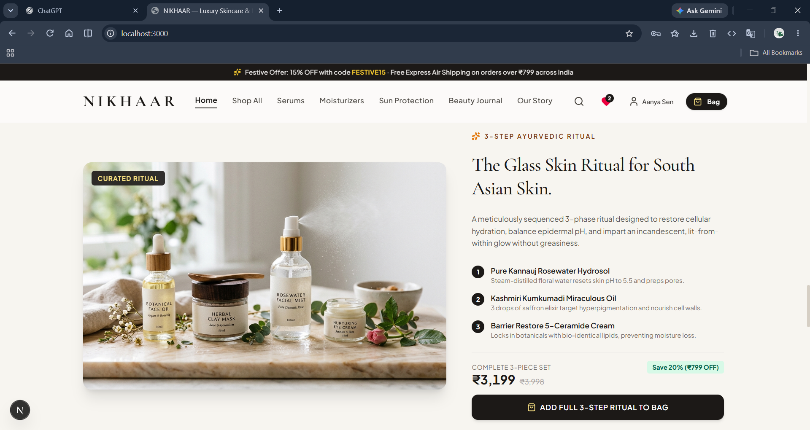
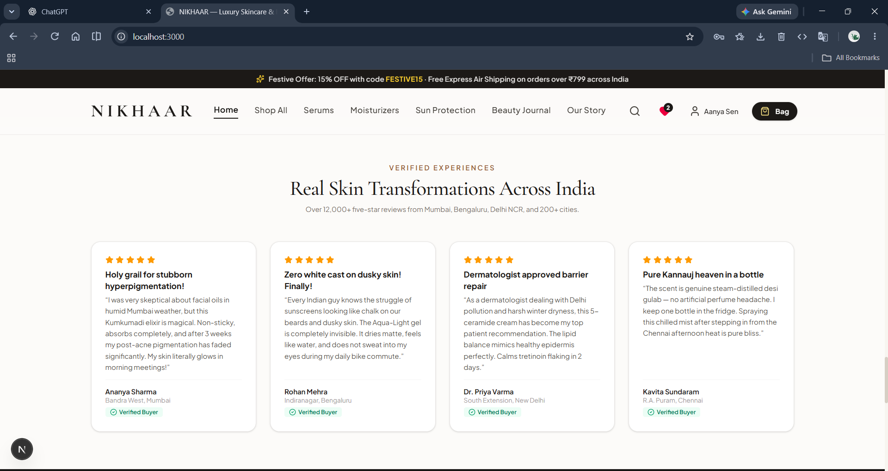
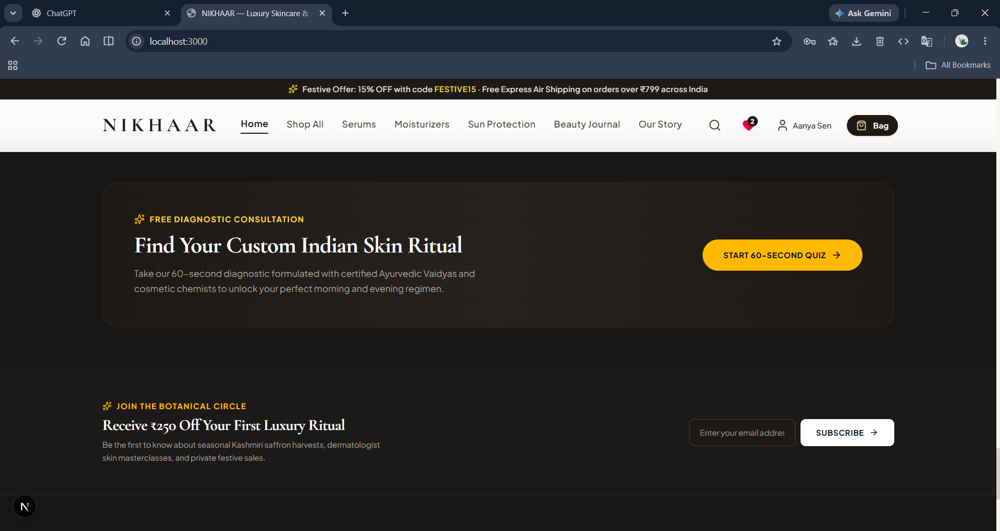
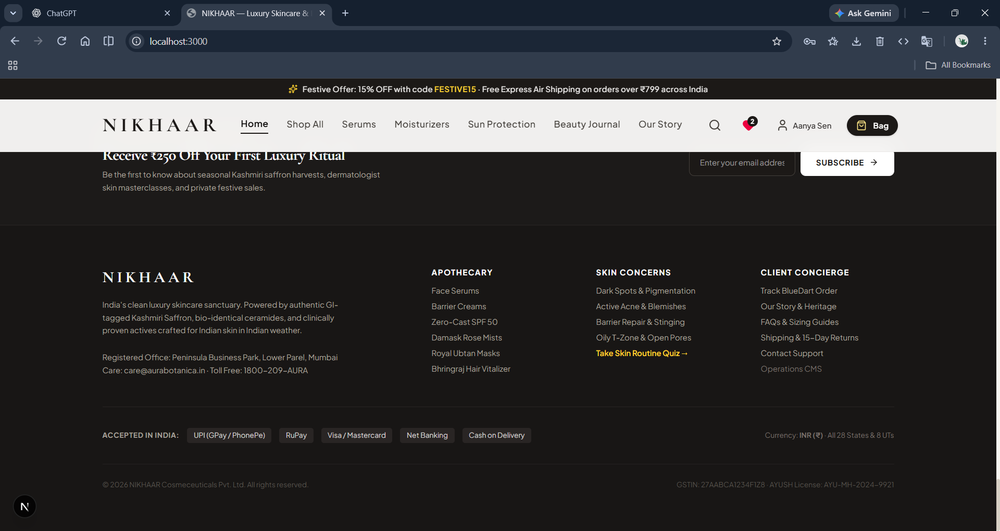
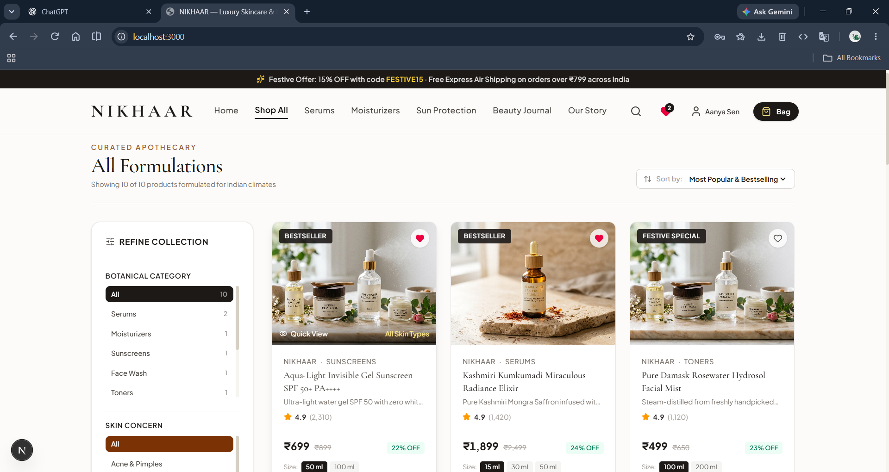
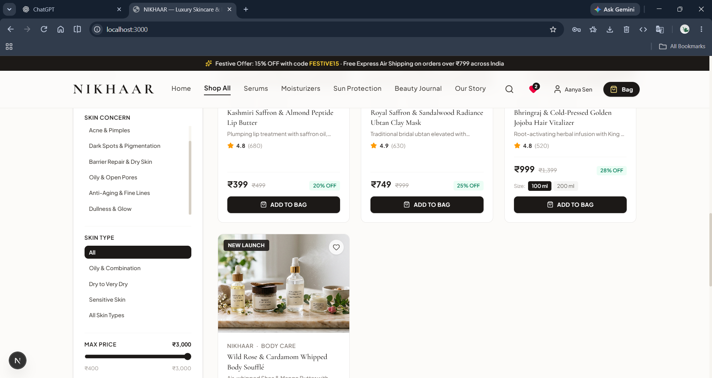
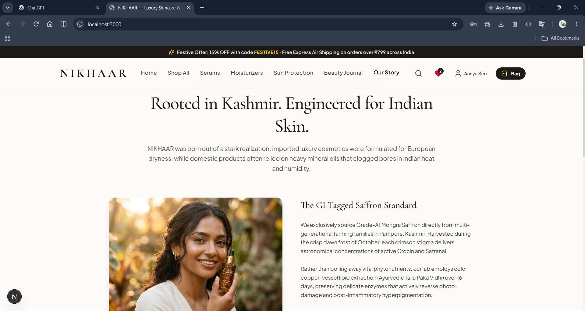

## Demo
[▶️!Demo](assets/nikhar.mp4)

## Overview

This project is a single-page storefront app with:

- Luxury beauty branding and editorial-style homepage
- Product discovery by category and skin concern
- Product detail pages with pricing, features, and review elements
- Shopping cart and checkout flow
- Order tracking and wishlist management
- User account and auth modals
- Blog and informational pages
- Skin quiz experience and diagnostic CTA

## Brand Focus

NIKHAAR is positioned around premium Indian skincare with a blend of:

- Ayurvedic ingredients and modern formulations
- Barrier repair and hydration-led routines
- SPF and sun protection products
- Clean, luxurious visual design
- Fast delivery and simplified digital commerce

## Tech Stack

- Next.js 15
- React 19
- TypeScript
- Tailwind CSS
- Lucide React icons
- ESLint

## Getting Started

### Prerequisites

- Node.js 18+
- npm or pnpm

### Install dependencies

```bash
npm install
```

### Run the development server

```bash
npm run dev
```

Open http://localhost:3000 in your browser.

### Production build

```bash
npm run build
```

### Start production server

```bash
npm run start
```

## Available Scripts

```bash
npm run dev      # Start local development server
npm run build    # Create production build
npm run start    # Run production build locally
npm run lint     # Run ESLint checks
npm run clean    # Clean Next.js cache/state
```

## Project Structure

```text
app/
  globals.css
  layout.tsx
  page.tsx

components/
  AdminDashboard.tsx
  AuthModal.tsx
  BestsellersSection.tsx
  BlogDetailPage.tsx
  BlogPage.tsx
  CartDrawer.tsx
  CheckoutPage.tsx
  Footer.tsx
  HeroSection.tsx
  InformationalPages.tsx
  Navbar.tsx
  OrderTrackingPage.tsx
  ProductCard.tsx
  ProductDetailPage.tsx
  SearchModal.tsx
  ShopAllPage.tsx
  SkinQuizModal.tsx
  ToastContainer.tsx
  UserAccountPage.tsx
  WishlistPage.tsx

context/
  StoreContext.tsx

lib/
  data.ts
  utils.ts
```

## Notes

This project is a front-end storefront prototype focused on elegant commerce UX and product storytelling. It is structured for easy extension with backend APIs, real authentication, and live product data integration.

## License

This project is for demonstration and portfolio purposes.
